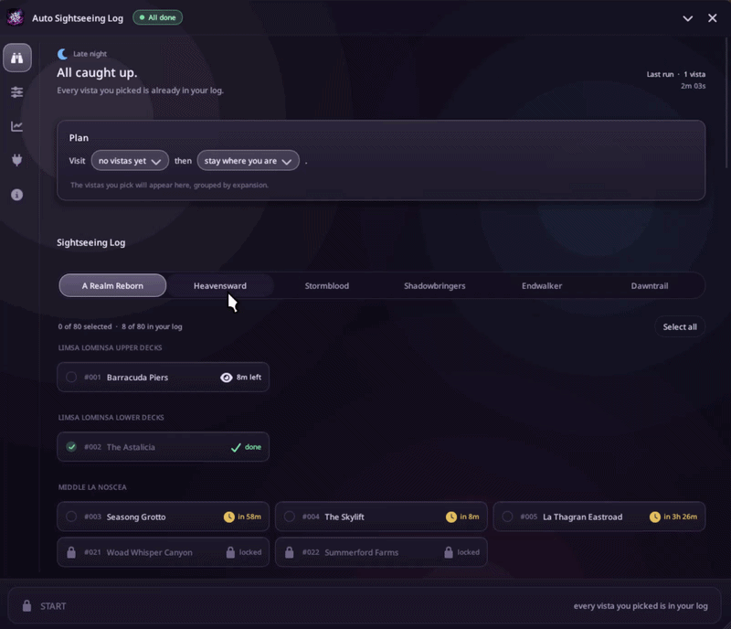

<p align="center">
  
</p>

<h1 align="center">Auto Sightseeing Log</h1>

<p align="center">
  <a href="https://discord.gg/hppkAvdBEE"></a>
  <a href="https://github.com/XeldarAlz/FFXIV-AutoSightseeingLog/releases/latest"></a>
  <a href="https://github.com/XeldarAlz/FFXIV-AutoSightseeingLog/releases"></a>
  <a href="https://github.com/XeldarAlz/FFXIV-AutoSightseeingLog/actions/workflows/release.yml"></a>
  <a href="LICENSE.md"></a>
</p>

<p align="center">
  <em>Sightseeing vistas, logged for you. Built on Dalamud.</em>
</p>

---

<p align="center">
  
</p>

## What it does

Lists every Sightseeing Log vista from A Realm Reborn through Dawntrail in one window, grouped by expansion and zone. Tick the vistas you want and press **Start**: the plugin teleports and flies to each one, waits for its hour and weather when it has them, performs the emote the log asks for, and moves on until every vista you picked is in your log.

## Features

- **The whole log**: all 340 vistas from A Realm Reborn through Dawntrail, grouped by zone, with the ones you haven't unlocked yet locked and what opens them one hover away.
- **Fresh characters**: if your Sightseeing Log itself is still locked, the run has Questionable complete “A Sight to Behold” for you first, then carries on to the vistas.
- **Live log progress**: reads which vistas you have logged straight from the game, so the window always matches your Sightseeing Log.
- **Time and weather windows**: works out when each A Realm Reborn vista's Eorzean hour and weather line up, and counts down to when it opens or closes.
- **Smart ordering**: visits open vistas before they close and lines up the rest for when their window opens. Settings has how long to wait on the spot for a window (20 minutes by default); a vista further out is left for a later run.
- **Travel**: teleports to the nearest aetheryte and flies or walks to the spot, including the vistas whose marker sits where you can't stand.
- **Jump puzzles**: climbs the city jump puzzles it has a route for (Bokairo Inn and Shiokaze Hostelry in Kugane, Ruveydah Fibers Rooftop Garden in Radz-at-Han, Hunu'iliy in Tuliyollal), picks the climb back up after a missed jump, and leaves the puzzles it has no route for to you.
- **The right emote**: performs /lookout, /pray, /comfort or whichever emote each vista asks for, and checks that the log recorded it.
- **Hard spots**: when a vista sits on something the plugin cannot get onto by itself, it marks the spot in the world, points an arrow at it from above your character, flashes the game in your taskbar if you are in another window, and waits up to a minute for you to stand inside before carrying on. Turn it off in Settings for unattended runs. Settings also has when the box and the arrow show (always, near the spot, only when it needs you, or never) and how large the arrow is.
- **Recovery**: re-paths, jumps, side-steps, or teleports out when it gets stuck on the way, and waits out a fight before it emotes.
- **After the run**: stay where you are, return to the inn, log out to title, or close the game once a run finishes by itself.
- **Pause & resume**: park a run without losing your progress, and auto-pause while you're in a duty.
- **History**: every run recorded with the vistas logged and the zones visited.

## Install

In-game: `/xlsettings` → **Experimental** → paste into **Custom Plugin Repositories**:

```
https://raw.githubusercontent.com/XeldarAlz/DalamudPlugins/main/repo.json
```

Tick **Enabled**, click **+**, then **Save and Close**. Open `/xlplugins` → **All Plugins**, search for **Auto Sightseeing Log**, and install.

The plugin needs a helper for movement to be installed and loaded. Open `/asl deps` after install to see it and install it in one click. The same page offers Questionable as an optional helper: with it installed, a run on a character that has not unlocked the Sightseeing Log yet completes “A Sight to Behold” by itself before the tour.

## Commands

| Command | Action |
|---|---|
| `/asl` | Toggle the main window |
| `/sightseeing` | Alias for `/asl` |
| `/asl config` | Open the Settings page |
| `/asl stats` | Open the History page |
| `/asl deps` | Open the Plugins page |
| `/asl about` | Open the About page |
| `/asl changelog` | Open the Changelog page |
| `/asl pause` | Pause or resume the current run |
| `/asl goto <number>` | Travel to a vista without logging it (debug helper); `/asl goto stop` cancels |
| `/asl logdump` | Write the Sightseeing Log state to the plugin log (debug helper) |
| `/asl record start` | Record a manual climb and save a frame-by-frame motion trace |
| `/asl record stop` | Finish the recording and print the route steps to the plugin log |

### Jump puzzle diagnostics

The jump controller verifies grounded starts, observes takeoff and touchdown, and learns a ballistic model from usable flight samples during each climb. It excludes grounded startup and stationary landing-animation frames from the arc fit, and accounts separately for movement between the jump action and physical takeoff. Moving jumps learn the relationship between run-up distance and airborne speed from at least two different observed run-ups, then use the actual remaining distance, height and available floor to select a launch frame. Acceleration is fitted separately from the observed speed ceiling so a long, capped-speed jump does not underpredict shorter jumps. Outside the measured model's range, it uses the route's recorded run-up distance. A collision or irregular flight is excluded from calibration. Sprint and Peloton are allowed to expire before launching.

The Kugane balcony section follows the successful October 18 recording. Its obstructed hops retain their recorded run-ups; a free-flight estimate cannot select a safe takeoff around an overhang. The walk off the balcony is an explicit drop, which follows the recorded destination without pressing Jump. After a fall onto a roof, recovery checks for a continuous walk over the collision surface back to a previously reached takeoff. It samples floor height, width and obstacles along the path, follows roof slopes at walking pace, and stops on lost footing or stalled movement. A successful return retries the climb with its existing calibration. Starting automation while standing on a roof also checks for a supported return. If no connected route point can be verified, it teleports to the zone's attuned aetheryte, verifies arrival, and travels back to the entrance to retry. It keeps the climb's calibration and retry counts, allowing at most eight misses overall and three on one leg. A failed teleport or user cancellation stops the reset; ground navigation never starts from an unverified elevated platform.

The roof entrance after the 64.31m post uses two standing hops from the October 18 09:55 UTC recording, landing at 65.58m and 66.35m before walking up the roof. Its old single-jump target at 66.48m exceeded the measured jump apex. The replacement preserves the observed hops without relaxing the height limit or using slope contacts to calibrate free-flight speed.

The following section through the 77.25m platform uses the successful portion of the 09:58 recording. Its downhill roof launch preserves the measured run-up and slope; the controller checks height against that slope and permits only a brief, bounded descent during jump startup. This transition does not calibrate the level-ground ballistic model. The route includes the actual turn-back position before the long jump and the short moving launch onto the 75.11m post. The recording's final failed jump is excluded.

Landing corrections distinguish a visible gap from a ray that cannot see the floor under an already grounded character. After a stable landing within 1 metre horizontally and 0.10 metre vertically of the recorded point, an unavailable ray allows a correction at walking pace, monitored every frame for lost footing. A supported floor path allows the usual 0.30 metre height tolerance. A hop that settles on a following recorded walk point can continue from that foothold without skipping another jump. Visible gaps still block corrections, and unrecorded recovery walks require verified floor. A blocked correction enters recovery, including the teleport reset if no local return is available. The narrow 54.51m ornament landing uses 3cm horizontal alignment before the short run-up observed in the successful 12:52 log; the later failed attempt started off-centre and lost height during startup. Failed jumps log launch position, speed, run-up distance, apex, longest frame, landing error and flight samples, with a separate diagnostic when no ascent was observed. These changes need in-game validation on the full tower; passing the offline tests does not establish that the route completes.

For a manual recording, start on the ground, use `/asl record start`, climb, and use `/asl record stop`. The log prints the CSV path under the plugin configuration's `jump-recordings` directory. The CSV retains time, position, facing, airborne state and walking mode every frame, including failed jumps. The recorder distinguishes walk-off drops from jumps by checking whether the character actually rose before descending. Attach the CSV with the failed bot-run log when investigating a route. Recording ends on a zone change or logout.

## Languages

The windows are available in English, Deutsch, Français, Español, Português (Brasil), Русский, Türkçe, 日本語, and 中文. The plugin picks a language from your Dalamud and game client settings on first launch; change it any time under Settings, General, Language. Game data such as zone, vista, emote, and weather names always follows the game client.

Spotted a wrong or awkward translation? Open a [translation issue](https://github.com/XeldarAlz/FFXIV-AutoSightseeingLog/issues/new?template=translation_report.yml) and tell me what it should say instead.

## Community

Questions, ideas, or just want to hang out with other players? Come say hi on Discord.

→ [Join our Discord](https://discord.gg/hppkAvdBEE)

## More from me

If you liked this plugin, take a look at my other Dalamud work. You might find something else there for you.

→ [XeldarAlz Dalamud Plugins](https://github.com/XeldarAlz/DalamudPlugins)

## License

AGPL-3.0-or-later. See [LICENSE.md](LICENSE.md). [NOTICE](NOTICE) adds the attribution terms the AGPL allows: a fork, or any project that reuses this code, must credit the original author and must not pass itself off as the original. The license covers the code, not the name or the icon: read the [trademark and naming policy](TRADEMARK.md) before you publish a fork.

Some vista facts the game data does not carry come from other projects; they are credited in [THIRD-PARTY-NOTICES.md](THIRD-PARTY-NOTICES.md).

How AI is used to build this plugin is written down in [AI usage](AI-USAGE.md).
